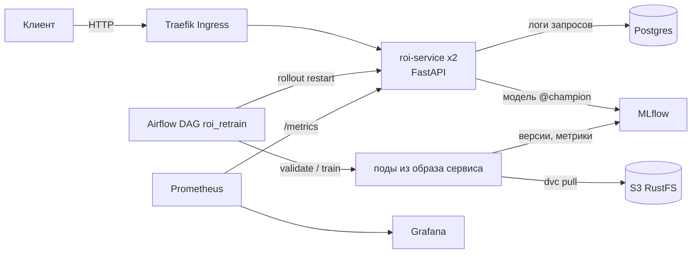

# REPORT

Результаты работы над сервисом по предсказанию roi на основе образования человека

Схема проекта




## Хранилища для данных разных форматов

| Хранилище | Что лежит |
| --- | --- | --- |
| git | код, манифесты, `uv.lock`, `.dvc/config` (без ключей), `data/*.dvc` (указатели) |
| DVC S3 (`s3://dvc`, RustFS) | сам CSV (`data/college_major_roi.csv`), версии данных |
| `.dvc/config.local` / k8s Secret `s3-credentials` | ключи S3 |
| MLflow (mlops, PVC) | эксперименты, метрики, артефакты моделей, версии и алиасы | 
| Postgres (default) | таблица `predictions` (каждый запрос по `request_id`) |
| k8s Secret `roi-service-secrets` | пароль Postgres, `DATABASE_URL` |


## Таблица ответов
| Пункт                   | Ссылка                                                                                                                                                                                        |
| ----------------------- | --------------------------------------------------------------------------------------------------------------------------------------------------------------------------------------------- |
| 2.2.1                     | прогон - https://github.com/BovaM/Task-1/actions/runs/36482818228/job/109132712749<br>пакет с образом - https://github.com/BovaM/Task-1/pkgs/container/task-1                                 |
| 2.2.2                     | PR - https://github.com/BovaM/Task-1/pull/2<br>Красный PR - https://github.com/BovaM/Task-1/actions/runs/36413605587<br>зеленый PR - https://github.com/BovaM/Task-1/actions/runs/36413880627 |
| 2.2.3 (ConfMap)           | Сломанный configmap.yaml - https://github.com/BovaM/Task-1/actions/runs/36474093574<br>Починенный - https://github.com/BovaM/Task-1/actions/runs/36474945638                          |
| 2.2.3 (deployment secret) | Сломанный секрет deployment.yaml - https://github.com/BovaM/Task-1/actions/runs/36475088181<br>Починенный - https://github.com/BovaM/Task-1/actions/runs/36475836511                          |
| 2.2.3 (deployment memory) | Сломанная память в deployment.yaml - https://github.com/BovaM/Task-1/actions/runs/36476524621<br>Починенный - https://github.com/BovaM/Task-1/actions/runs/36477562857                        |
| 3.2.1 Платформа в кластере | docs/screenshots/01.png - итоговый kubectl get pods,ingress -A с рабочими pod и обоими Ingress. docs/screenshots/02.png - MLflow на mlflow.localhost |
| 3.2.2 Обучение, Registry и gate | docs/screenshots/03.png - версии модели и Aliases. docs/screenshots/04.png` - PR curve. **Нужно добрать правильные 3 запуска gate: promoted=true, false, true** |
| 3.2.3 Сервис по alias и откат модели | docs/screenshots/05-model-rollback.png - /health до и после отката и время отката |
| 3.2.4 CI/CD в свой kind | Зеленый deploy: https://github.com/BovaM/Task-1/actions/runs/37375239697  docs/screenshots/06.png - Settings -> Actions -> Runners |
| 3.2.5 DVC | data/college_major_roi.csv.dvc в репозитории. docs/screenshots/07.png - dvc push, dvc diff, dvc pull. docs/screenshots/08.png - два MLflow run с разными data_md5 |
| 3.2.6 HPA | docs/screenshots/09.png - рост и падение реплик. docs/screenshots/10.png - SuccessfulRescale. docs/screenshots/11.png - CPU и memory pod под нагрузкой |
| 3.2.7.1 Нет alias модели | Красный: https://github.com/BovaM/Task-1/actions/runs/37380705157/job/112002066311  Зеленый: https://github.com/BovaM/Task-1/actions/runs/37382159082 |
| 3.2.7.2 Неверный KIND_CLUSTER | Красный: https://github.com/BovaM/Task-1/actions/runs/37382451682 Зеленый: https://github.com/BovaM/Task-1/actions/runs/37382643419 |
| 3.2.7.3 Ingress host mismatch | Красный: https://github.com/BovaM/Task-1/actions/runs/37383872098  Зеленый: https://github.com/BovaM/Task-1/actions/runs/37384298336 |
| 4.1.1 | Платформа одной командой, `kubectl get pods -A` | `docs/screenshots/pods.png`; поднятие с нуля по README заняло <N мин> |
| 4.1.2 | Quickstart в README | [README](README.md#quickstart) |
| 4.2 | Скрин дашборда под трафиком | `docs/screenshots/grafana_traffic.png` |
| 4.3.1 | Файл `.dvc` | [data/college_major_roi.csv.dvc](data/college_major_roi.csv.dvc) |
| 4.3.2 | Бакет в консоли S3 | `docs/screenshots/s3_bucket.png` |
| 4.3.3 | `docker run --rm <образ> ls data`: только `.dvc` | <вставьте вывод> |
| 4.4.1 | Зелёный CI с тестами pandera | <ссылка на прогон> |
| 4.4.2 | Прогон `validate` с `valid=false` и `failure_cases.csv` | `docs/screenshots/validate_false.png` |
| 4.5.1 | Сценарий 1: новая версия лучше | граф DAG `docs/screenshots/dag_s1.png`, MLflow <ссылка/скрин> |
| 4.5.2 | Сценарий 2: гейт не пустил | `docs/screenshots/dag_s2.png` |
| 4.5.3 | Сценарий 3: плохая выгрузка и откат | `docs/screenshots/dag_s3_red.png`, `dag_s3_green.png` |
| 4.5.4 | Model registry с колонкой Aliases | `docs/screenshots/registry.png` |
| 4.5.5 | Дашборд с переключением версии и вывод генератора трафика | `docs/screenshots/version_switch.png`, вывод ниже |
| 4.6 | Зелёный прогон deploy на своём runner | <ссылка на прогон> |


# Работа 2
## Часть 2
### 1. Пайплайн для сервиса

Обновленный интеграционный тест с test_prediction_is_logged и test_garbage_logged_422
ConfigMap обновил теперь там есть порог ожидается что он будет 0,5
Смоук тест в ci обновлен, чтобы смотреть на ответ и его смысл

Было много неудачных прогонов из-за проблем с .yaml файлами для k8s
Не сразу разобрался без документации какие имена можно с _, а какие нет, в какой-то момент поменял все и сломалось тоже все. Там возникала ошибка, что он умирал на test и не мог либо базу данных найти, либо жаловался на имена
(Важно помнить что _ допустим только в именах связанных с DB, а все, что относится к docker и kubernetes в именах идет с -) 

Прогон (не первый, понял что забыл smoke тест добавить его тоже добавлял сверху)
https://github.com/BovaM/Task-1/actions/runs/36482818228

### 2. Процесс ветка и pull-request

Собственно pull-request
https://github.com/BovaM/Task-1/pull/2
Созданно их было два, потому что с первым почему-то ci не работал и в actions его нету, я создал еще один, с которым уже все получилось, сначала не шел ci, оказалось проблема в одном из тестов, которые я делал для прошлой итерации и я убрал его

Красный PR
https://github.com/BovaM/Task-1/actions/runs/36413605587
После этого исправленный зеленый PR
https://github.com/BovaM/Task-1/actions/runs/36413880627

### 3. Три красных прогона

Сломанный ConfMap 
https://github.com/BovaM/Task-1/actions/runs/36474093574

Починенный
https://github.com/BovaM/Task-1/actions/runs/36474945638

При сломанной ссылке на модель у пода статус CrashLoopBackOff а ошибка сама выдает 
[Errno 2] No such file or directory: 'artifacts/no_model.joblib'
ERROR:    Application startup failed. Exiting
Видим, что под за время выкатки успел 4 раза упасть ну и раз не запустился значит он тут же упал, из этого можно сделать вывод, что проблема не в конфигурации кубернетеса, а в коде приложения
В коде ошибки видим, что сервис (app.py) в lifespan пытается загрузить модель, но ничего не получается и код падает с ошибкой 


Сломанный секрет deployment.yaml
https://github.com/BovaM/Task-1/actions/runs/36475088181

Починенный
https://github.com/BovaM/Task-1/actions/runs/36475836511

Мы сломали в deployment секрет - под пытается использовать переменные из сломанного секрета, но его не существует, поэтому создание контейнера даже не стартует
Собственно в логах по этому случаю видим CreateContainerConfigError 
Кубернетис нам пишет - Error from server (BadRequest): container "api" in pod "roi-service-74b7f7f5c6-2lcql" is waiting to start: trying and failing to pull image
А вот сломанный секрет
Environment Variables from:
      roi-service-config         ConfigMap  Optional: false
      roi-service-secrets-break  Secret     Optional: false
Ошибка в названии не дает получить доступ к паролю 


Сломанная память в deployment.yaml
https://github.com/BovaM/Task-1/actions/runs/36476524621

Починенный
https://github.com/BovaM/Task-1/actions/runs/36477562857

Мы сломали объем памяти в requests
У пода при этой ошибке статус pending - то есть он умирает на стадии планирования запуска, нет попыток скачать образ или собрать конфиг 

## Часть 3

1. Сколько секунд шёл job build в первом прогоне и сколько во втором? Какой слой Dockerfile
взят из кэша и почему именно он?

В первом прогоне, где был build длительность job 56 с
https://github.com/BovaM/Task-1/actions/runs/36351860867
Во втором 20 с (почти в 3 раза быстрее)
https://github.com/BovaM/Task-1/actions/runs/36352172324

Если посмотреть, то наибольшее сокращение времени у Run docker/build-push-action@v4 с 36 с до 3 с


2. В логе deploy во время выката видны поды в ImagePullBackOff, а прогон при этом зелёный.
Откуда эти поды и почему это не ошибка?

Это происходит потому что старые поды от предыдущего деплоя, которые не удалены потому, что rollout в процессе выполнения
kind не всегда успевает подтянуть новый образ на все ноды и пока у нас не будет нужно число реплик нужного нам пода
Старые ноды не удаляются, пока идет rolling update, прогон при этом остается зеленым потому, что kubectl rollout status проверяет готовность нового ReplicaSet

3. Какой путь проходит пароль базы от страницы настроек GitHub до переменной окружения
в поде? Почему его нельзя положить в configmap.yaml?

- Сначала пароль кладется в GitHub Settings в secret у нас это "DB_PASSWORD"
- GitHub Actions достает значение секрета и кладет в переменную окружения shell, который выполняется run 
- Потом kubernetes создает секрет за счет обращения в kind-кластер
- Deployment получает доступ к ключу через secretKeyRef (кстати kubernetes кодирует значения переменных для настройки доступа по RBAC)

В configmap хранить пароль нельзя - значения будут видны в открытом виде любому, у кого будет доступ к репозиторию. Это плохо потому что тогда будет доступ к базе данных логов всех ответов сервиса 

4. Уберите мысленно needs: tests у job build. Опишите сценарий, в котором это закончится
плохо.

Это плохо потому, что процесс сборки и тестирования начнет идти параллельно и сборка, а после и деплой могут закончиться раньше, что создаст образ сервиса. Потом окажется, что тесты красные и наша модель отдает на все запросы 1 число. Сервис не падает, но при этом и не работает - CI нам как бы помог, но на самом деле ничем не помог и мы выкатили в продакшен сломанный сервис

5. Почему на pull request у вас бегут только тесты, а build и deploy нет? Какая строка за это
отвечает и зачем так сделано?

У build стоит if: github.ref == 'refs/heads/main', а deploy needs build
Это условие, которое говорит использовать build только на ветке main, а мы когда делаем PR будет merge в конце и он просто не выполнится.
Это нужно, чтобы выполнять сборку не для какой-то ветки, которая мерджится в основную, а только основной 

6. Зачем в init() стоит pg_advisory_xact_lock? Что произойдёт без него при двух репликах и
пустой базе? Реплики чего именно здесь имеются в виду?

pg_advisory_xact_lock нужен, чтобы инициализация пустой базы осуществлялась только 1 репликой приложения одновременно. Если 2 реплики одновременно увидят пустую базу, они начнут создавать одни и те же таблицы и начальные данные, что может привести к Data race и ошибкам сервисов. Реплики - поды из Kubernetes: как мы помним kubernetes гарантирует, что у нас работает постоянное число подов, то есть копий нашего сервиса, между которыми распределяется трафик

7. В трёх ваших красных прогонах поды застряли в трёх разных статусах. Расположите эти ста‐
тусы в порядке жизни пода и объясните, на каком шаге возникает каждый.

На основе проведенных красных тестов можно составить набор состояний для подов 
Самый ранний 
- Pending - под не запустился, создан deployment, но не дошел ни до одной ноды, ждет когда такая возможность появится 
- CreateContainerConfigError - контейнер не удается создать из-за его конфигурации (в окружении не хватает какой-то переменной и запуск не происходит - у нас это было отсутствие секрета)
- CrashLoopBackOff - контейнер запускается и падает, а платформа постоянно пытается его перезапустить (процесс запускается, под поднимается, но ломается сам сервис - у нас lifespan, который все ломает, kubernetes видит, что не получается создать нужное число реплик и поднимает еще)
(Самый поздний)


# Работа 3

## Часть 2
### 1. Платформа
Поднял кластер с mlflow и ingress. Получилось не сразу из-за того, что был старый контейнер, в котором не распознавался mlflow но включить - выключить помогло
Получилась вот такое состояние у кластера

```
NAMESPACE            NAME                                              READY   STATUS    RESTARTS   AGE
default              pod/postgres-b6764f6b5-b8dk6                      1/1     Running   0          3h3m
default              pod/roi-service-847d5d4cf6-m5x95                  1/1     Running   0          22m
default              pod/roi-service-847d5d4cf6-vl64z                  1/1     Running   0          22m
kube-system          pod/coredns-559f6c778d-qlshj                      1/1     Running   0          4h57m
kube-system          pod/coredns-559f6c778d-x8bkz                      1/1     Running   0          4h57m
kube-system          pod/etcd-mlpro-control-plane                      1/1     Running   0          4h57m
kube-system          pod/kindnet-7zwrw                                 1/1     Running   0          4h57m
kube-system          pod/kube-apiserver-mlpro-control-plane            1/1     Running   0          4h57m
kube-system          pod/kube-controller-manager-mlpro-control-plane   1/1     Running   0          4h57m
kube-system          pod/kube-proxy-s85cr                              1/1     Running   0          4h57m
kube-system          pod/kube-scheduler-mlpro-control-plane            1/1     Running   0          4h57m
kube-system          pod/metrics-server-995d47bd7-tl8jf                1/1     Running   0          135m
local-path-storage   pod/local-path-provisioner-75f7fc7dc5-29dps       1/1     Running   0          4h57m
mlops                pod/mlflow-9f98c4469-xktsk                        1/1     Running   0          4h47m
traefik              pod/traefik-6d88bc478f-2zzhk                      1/1     Running   0          4h48m

NAMESPACE   NAME                                    CLASS     HOSTS              ADDRESS   PORTS   AGE
default     ingress.networking.k8s.io/roi-service   traefik   roi.localhost                80      3h20m
mlops       ingress.networking.k8s.io/mlflow        traefik   mlflow.localhost             80      4h42m
```

Зато после борьбы все-таки открылся локалхост с MLflow чему я был очень рад


### 2. Обучение реестр и гейт
Тут получилась веселая ситуация потому что у меня модель с первого же прогона получилась очень хорошей и в итоге champion я мог менять только ручками
При запуске получил логи
```Created version '2' of model 'roi'.
🏃 View run ambitious-conch-420 at: http://mlflow.localhost/#/experiments/1/runs/3b9b39365527409ea52e41713f74385b
🧪 View experiment at: http://mlflow.localhost/#/experiments/1
{"run_id": "3b9b39365527409ea52e41713f74385b", "version": "2", "pr_auc": 0.9938, "champion_before": "1", "champion_pr_auc_before": 0.9938195254449789, "promoted": false}

Created version '3' of model 'roi'.
🏃 View run righteous-zebra-997 at: http://mlflow.localhost/#/experiments/1/runs/9d49ef555d334ed187ce0edd23c51429
🧪 View experiment at: http://mlflow.localhost/#/experiments/1
{"run_id": "9d49ef555d334ed187ce0edd23c51429", "version": "3", "pr_auc": 0.96, "champion_before": "1", "champion_pr_auc_before": 0.9938195254449789, "promoted": false}

Created version '4' of model 'roi'.
🏃 View run popular-panda-657 at: http://mlflow.localhost/#/experiments/1/runs/63799b54e2e94a43bb86e0dbd07a97fa
🧪 View experiment at: http://mlflow.localhost/#/experiments/1
{"run_id": "63799b54e2e94a43bb86e0dbd07a97fa", "version": "4", "pr_auc": 0.9938, "champion_before": "1", "champion_pr_auc_before": 0.9938195254449789, "promoted": false}
 ```

на картинке видно что у нас есть alias для моделей собственно champion и challenger

### 3. Сервис по alias и откат модели
Руками меняем alias для моделей
Как было мы видели посмотрим как стало


Переставил метку champion
{"status":"ok","model_version":"1","prediction_threshold":0.9858}
и потом 
{"status":"ok","model_version":"3","prediction_threshold":0.8343}

Измерение времени показало TotalSeconds      : 13,1452893

### 4. CI в локальном кластере
Интересным образом все застряло из-за того, что я слишком рано запустил PR и все мерджи встали в очередь, после принудительного merge пайплайны начали снова работать

https://github.com/BovaM/Task-1/actions/runs/37375239697
Довольно быстро на самом деле все получилось что даже как-то удивительно было относительно дургих частей работы


### 5. Версии данных в DVC
Вынесли наш датасет из репозитория и теперь все в умном хранилище
Я сделал 2 версии датасета, вторая урезанная по выбросам
Ошибся тут в простом месте долго не мог понять что надо убрать data из gitignore и dvc с ней сам разбирается, а потом еще загрузил пустой файл
uv run dvc push
Collecting                                                                                                                           |0.00 [00:00,    ?entry/s]
Pushing
Everything is up to date.

Но потом я все поправил
uv run dvc push                                     
Collecting                                                                                                                           |1.00 [00:00, 66.8entry/s]
Pushing
1 file pushed                                               

При переносе в клон
uv run dvc pull
warning: `VIRTUAL_ENV=C:\Users\Piwi\Desktop\postupashki\Task_1\.venv` does not match the project environment path `.venv` and will be ignored; use `--active` to target the active environment instead
Collecting                                                                                                                           |1.00 [00:00,  254entry/s]
Fetching
Building workspace index                                                                                                             |1.00 [00:00, 57.1entry/s]
Comparing indexes                                                                                                                   |3.00 [00:00, 3.06kentry/s]
Applying changes                                                                                                                     |1.00 [00:00,  31.0file/s]
A       data\college_major_roi.csv
1 file fetched and 1 file added

uv run dvc diff 3831525 b8568bc
Modified:
    data\college_major_roi.csv


Картинки


### 6. HPA и его автомасштабирование

Для kind установлен metrics-server. HPA настроен на roi-service:
- minReplicas: 2
- maxReplicas: 6
- target CPU: 60%

У меня было 3 запуска, из которых один по воле случая оказался прям плохой 
Нормальный:
kubectl get hpa -w
NAME          REFERENCE                TARGETS       MINPODS   MAXPODS   REPLICAS   AGE
roi-service   Deployment/roi-service   cpu: 3%/60%   2         6         2          22s
roi-service   Deployment/roi-service   cpu: 4%/60%   2         6         2          3m31s
roi-service   Deployment/roi-service   cpu: 3%/60%   2         6         2          3m46s
roi-service   Deployment/roi-service   cpu: 35%/60%   2         6         2          4m1s
roi-service   Deployment/roi-service   cpu: 81%/60%   2         6         2          4m16s
roi-service   Deployment/roi-service   cpu: 5%/60%    2         6         3          4m31s
roi-service   Deployment/roi-service   cpu: 3%/60%    2         6         3          4m46s
roi-service   Deployment/roi-service   cpu: 39%/60%   2         6         3          5m1s
roi-service   Deployment/roi-service   cpu: 748%/60%   2         6         3          5m16s
roi-service   Deployment/roi-service   cpu: 906%/60%   2         6         6          5m31s
roi-service   Deployment/roi-service   cpu: 916%/60%   2         6         6          5m46s
roi-service   Deployment/roi-service   cpu: 751%/60%   2         6         6          6m1s
roi-service   Deployment/roi-service   cpu: 803%/60%   2         6         6          6m16s
roi-service   Deployment/roi-service   cpu: 799%/60%   2         6         6          6m31s
roi-service   Deployment/roi-service   cpu: 843%/60%   2         6         6          6m46s
roi-service   Deployment/roi-service   cpu: 827%/60%   2         6         6          7m1s
roi-service   Deployment/roi-service   cpu: 807%/60%   2         6         6          7m17s
roi-service   Deployment/roi-service   cpu: 809%/60%   2         6         6          7m32s
roi-service   Deployment/roi-service   cpu: 761%/60%   2         6         6          7m47s
roi-service   Deployment/roi-service   cpu: 824%/60%   2         6         6          8m2s
roi-service   Deployment/roi-service   cpu: 817%/60%   2         6         6          8m17s
roi-service   Deployment/roi-service   cpu: 814%/60%   2         6         6          8m32s
roi-service   Deployment/roi-service   cpu: 803%/60%   2         6         6          8m47s
roi-service   Deployment/roi-service   cpu: 689%/60%   2         6         6          9m2s
roi-service   Deployment/roi-service   cpu: 80%/60%    2         6         6          9m17s
roi-service   Deployment/roi-service   cpu: 3%/60%     2         6         6          9m32s

Плохой
NAME          REFERENCE                TARGETS       MINPODS   MAXPODS   REPLICAS   AGE
roi-service   Deployment/roi-service   cpu: 3%/60%   2         6         2          15m
roi-service   Deployment/roi-service   cpu: 597%/60%   2         6         2          15m
roi-service   Deployment/roi-service   cpu: 1000%/60%   2         6         4          16m
roi-service   Deployment/roi-service   cpu: 981%/60%    2         6         6          16m
roi-service   Deployment/roi-service   cpu: 763%/60%    2         6         6          16m
roi-service   Deployment/roi-service   cpu: 799%/60%    2         6         6          16m
roi-service   Deployment/roi-service   cpu: 719%/60%    2         6         6          17m
roi-service   Deployment/roi-service   cpu: 737%/60%    2         6         6          17m
roi-service   Deployment/roi-service   cpu: 752%/60%    2         6         6          17m
roi-service   Deployment/roi-service   cpu: 716%/60%    2         6         6          17m
roi-service   Deployment/roi-service   cpu: 664%/60%    2         6         6          18m
roi-service   Deployment/roi-service   cpu: 672%/60%    2         6         6          18m
roi-service   Deployment/roi-service   cpu: 717%/60%    2         6         6          18m
roi-service   Deployment/roi-service   cpu: 776%/60%    2         6         2          18m
roi-service   Deployment/roi-service   cpu: 786%/60%    2         6         4          19m
roi-service   Deployment/roi-service   cpu: <unknown>/60%   2         6         6          19m
roi-service   Deployment/roi-service   cpu: 192%/60%        2         6         6          19m
roi-service   Deployment/roi-service   cpu: 3%/60%          2         6         6          20m

Вот там получилось 
Type     Name                                                                          # reqs      # fails |    Avg     Min     Max    Med |   req/s  failures/s
--------|----------------------------------------------------------------------------|-------|-------------|-------|-------|-------|-------|--------|-----------
POST     /v1/predict                                                                    22767   106(0.47%) |    316       3    2849    190 |   95.06        0.44
--------|----------------------------------------------------------------------------|-------|-------------|-------|-------|-------|-------|--------|-----------
         Aggregated                                                                     22767   106(0.47%) |    316       3    2849    190 |   95.06        0.44


Прогон	Users	Requests	Peak replicas	p95	CPU на pod	Errors
1	60	37133	20	280 ms	~0,8	2
2	60	22767	20	1100 ms	~0,8	106
3	60	39729	20	140 ms	~0,8	2

По расширеням числа подов
Events:
  Type     Reason                        Age                From                       Message
  ----     ------                        ----               ----                       -------
  Normal   SuccessfulRescale             27m                horizontal-pod-autoscaler  New size: 3; reason: cpu resource utilization (percentage of request) above target
  Normal   SuccessfulRescale             17m                horizontal-pod-autoscaler  New size: 2; reason: All metrics below target
  Normal   SuccessfulRescale             12m (x2 over 15m)  horizontal-pod-autoscaler  New size: 4; reason: cpu resource utilization (percentage of request) above target
  Normal   SuccessfulRescale             12m (x3 over 26m)  horizontal-pod-autoscaler  New size: 6; reason: cpu resource utilization (percentage of request) above target
  Normal   SuccessfulRescale             75s                horizontal-pod-autoscaler  New size: 4; reason:
  Warning  FailedGetResourceMetric       60s (x3 over 12m)  horizontal-pod-autoscaler  failed to get cpu utilization: did not receive metrics for targeted pods(pods might be unready)
  Warning  FailedComputeMetricsReplicas  60s (x3 over 12m)  horizontal-pod-autoscaler  invalid metrics (1 invalid out of 1), first error is: failed to get cpu resource metric value: failed to get cpu utilization: did not receive metrics for targeted pods (pods might be unready)
  Normal   SuccessfulRescale             45s                horizontal-pod-autoscaler  New size: 6; reason: All metrics below target

  По CPU сводная статистика исходя из 
  

### 7. 3 красных прогона

Поменяное имя в configmap
Красный коммит
https://github.com/BovaM/Task-1/actions/runs/37380705157/job/112002066311
configmap/roi-service-config configured
deployment.apps/roi-service configured
horizontalpodautoscaler.autoscaling/roi-service unchanged
ingress.networking.k8s.io/roi-service unchanged
deployment.apps/postgres unchanged
service/postgres unchanged
service/roi-service unchanged
deployment.apps/roi-service image updated
Waiting for deployment "roi-service" rollout to finish: 0 out of 2 new replicas have been updated...
Waiting for deployment "roi-service" rollout to finish: 0 out of 2 new replicas have been updated...
Waiting for deployment "roi-service" rollout to finish: 1 out of 2 new replicas have been updated...
Waiting for deployment "roi-service" rollout to finish: 1 out of 2 new replicas have been updated...
error: timed out waiting for the condition

Из-за смены названия не смогли найти модель и ничего не запустилось в логах видно, что config map поменялся

Зеленый проход
https://github.com/BovaM/Task-1/actions/runs/37382159082


Смена имени kind-кластера в ci.yaml
Красный проход
https://github.com/BovaM/Task-1/actions/runs/37382451682

Run B=~/.local/bin && mkdir -p $B && echo "$B" >> "$GITHUB_PATH"
=~/.local/bin && mkdir -p $B && echo "$B" >> "$GITHUB_PATH"
[ -x $B/kind ] || curl -sSLo $B/kind [https://kind.sigs.k8s.io/dl/v0.33.0/kind-linux-amd64](https://kind.sigs.k8s.io/dl/v0.33.0/kind-linux-amd64)
[ -x $B/kubectl ] || curl -sSLo $B/kubectl [https://dl.k8s.io/v1.37.0/bin/linux/amd64/kubectl](https://dl.k8s.io/v1.37.0/bin/linux/amd64/kubectl)
chmod +x $B/kind $B/kubectl
$B/kind export kubeconfig --name "$KIND_CLUSTER" --internal
$B/kubectl get nodes
shell: /usr/bin/bash -e {0}
env:
KIND_CLUSTER: not_mlpro
IMAGE: ghcr.io/bovam/task-1:sha-c8629baf84f6a210a44871aa73b3a498ec3a662d
ERROR: could not locate any control plane nodes for cluster named 'not_mlpro'. Use the --name option to select a different cluster


Кластер просто не поднимается
Зеленый прогон
https://github.com/BovaM/Task-1/actions/runs/37382643419


Ingress мимо

(некоторые пуши зеленые, хотя у них сломанные файлы, потому что тесты на уровне deploy не проходят из-за работы через локальный раннер)
Run U="http://$KIND_CLUSTER-control-plane:30080"; H="Host: roi.localhost"
U="http://$KIND_CLUSTER-control-plane:30080"; H="Host: roi.localhost"


curl --fail -s --retry 5 --retry-all-errors -H "$H" $U/health | tee health.json; echo

grep -Eq '"model_version":"[0-9]+' health.json

curl --fail -s -X POST -H "$H" $U/v1/predict -H "Content-Type: application/json" -d @good.json | tee pred.json; echo

sleep 2

RID=$(jq -r .request_id pred.json)
kubectl exec deploy/postgres -- psql -U postgres -d roi_service -tAc "SELECT count(*) FROM predictions WHERE request_id = '$RID'" | grep -qx 1
shell: /usr/bin/bash -e {0}
env:
KIND_CLUSTER: mlpro
IMAGE: ghcr.io/bovam/task-1:sha-a51c8cfbcc9e62ed7b9ff587dbbff0b27d94a906


Зеленый проход
https://github.com/BovaM/Task-1/actions/runs/37384298336

### Часть 3

1. Почему tests и build идут в GitHub, а deploy нет?
Tests и build не требуют доступа к моему локальному Kubernetes, у них оно на ubuntu-latest в GitHub. Kind-кластер работает локально и снаружи GitHub к его API доступа нет, поэтому deploy выполняет self-hosted runner рядом с кластером.

2. Зачем runner нужны --network kind, Docker socket и --group-add 0?
--network kind подключает контейнер runner к Docker-сети kind, поэтому он видит mlpro-control-plane и может работать с внутренним kubeconfig. Без этой сети runner не сможет подключиться к control plane по его внутреннему имени.
Docker socket нужен для команд docker и kind, в том числе для загрузки образа в кластер. --group-add 0 дает процессу runner права на доступ к смонтированному Docker socket, иначе можно получить permission denied.

3. Почему Secret создается через --dry-run=client -o yaml | kubectl apply?
Обычный kubectl create secret успешно работает только первый раз. На следующем deploy объект уже существует и команда завершится ошибкой AlreadyExists.
--dry-run=client -o yaml | kubectl apply -f - сначала генерирует manifest, а apply создает Secret или обновляет уже существующий. Поэтому повторный deploy остается идемпотентным.

4. Чем challenger отличается от champion и зачем сервису alias?
challenger - новая версия-кандидат. champion - версия, которая прошла gate и должна использоваться сервисом.
Сервис запрашивает alias, а не номер версии, поэтому модель можно откатить без пересборки Docker image. Для модели достаточно перевесить champion и перезапустить pod. rollout undo решает другую задачу: он откатывает код и конфигурацию Deployment на предыдущий ReplicaSet.

5. Что будет, если в кластере еще никто не обучил модель?
Сервис на старте запросит models:/roi@champion, но Registry не сможет вернуть такую модель или alias. Lifespan приложения завершится ошибкой, pod начнет перезапускаться, а rollout не завершится.
В k9s или kubectl get pods это будет видно по CrashLoopBackOff или растущему RESTARTS. В CI будет timeout на kubectl rollout status, а в логах pod будет ошибка MLflow о том, что модель или alias не найден.

6. Как запрос из браузера доходит до MLflow?
Браузер идет на http://mlflow.localhost через host port 80. Kind при создании кластера пробрасывает этот порт на порт 30080 control-plane контейнера, дальше запрос принимает Traefik, правило Ingress mlflow.localhost направляет его в Service mlflow, а Service уже отправляет запрос на pod MLflow на порт 5000.
allowed-hosts ограничивает допустимые Host headers, а cors-allowed-origins разрешает запросы из нужного browser origin. Host port 80 задается при создании kind-кластера, потому что это Docker port mapping контейнера-ноды. Обычным Kubernetes manifest потом этот mapping к уже созданному Docker-контейнеру не добавить.

7. Сколько реплик должен был выставить HPA?
Формула из лекции:
replicas = ceil(currentReplicas * currentMetric / targetMetric)
В моем логе при 2 репликах CPU был 81%, а target 60%:
ceil(2 * 81 / 60) = ceil(2.7) = 3
HPA действительно выставил 3 реплики. Позже при 3 репликах метрика выросла до 748%:
ceil(3 * 748 / 60) = ceil(37.4) = 38
Но maxReplicas=6, поэтому HPA выставил максимум 6, что и видно в логе. Вниз реплики уходят медленнее из-за стандартного окна стабилизации scale down примерно 5 минут, чтобы HPA не менял число pod на каждом коротком провале нагрузки.
8. Что лежит в Git, а что в DVC и как восстановить данные модели N?

В Git лежат код, конфиги, uv.lock и файл data/college_major_roi.csv.dvc. В .dvc хранится хэш и путь, а сам CSV лежит в DVC remote.
Чтобы восстановить данные модели версии N, открываю ее run в MLflow и смотрю data_md5. Затем нахожу Git commit, где .dvc-указатель соответствует этому хэшу, переключаюсь на этот commit или беру из него .dvc файл и выполняю uv run dvc pull или uv run dvc checkout. После этого можно еще раз посчитать MD5 CSV и проверить, что он совпадает с data_md5 из MLflow.


# Работа 4

## Часть 2
Прогоны и что получилось


## Часть 3 - 8 вопросов

1. У вас в реестре версия N модели. По шагам: как восстановить ровно тот код и те данные, на
которых она обучена? Какие поля прогона MLflow и какие файлы в git для этого нужны?

В реестре MLflow надо открыть версию N и перейти к прогону, которым она создана.
В прогоне лежат параметр data_md5 (версия данных) и git-коммит кода.
Затем git checkout, в нём лежит указатель data/college_major_roi.csv.dvc, и dvc pull вернёт файл с этим md5 из S3. Для этого нужны поля прогона data_md5 и коммит, а в git файл .dvc и dvc.lock/код на этом коммите.

2. Почему данные не в образе, а указатели в образе? Что сломается, если сделать git push раньше dvc push, и где вы это увидите?

Данные большие и меняются независимо от кода - образ с данными пришлось бы пересобирать при каждом обновлении датасета, а версии данных не были бы видны.
Указатель весит байты и однозначно задаёт версию. Если запушить код раньше данных, в прод попадёт указатель на md5, которого ещё нет в S3, и dvc pull в поде validate или train в Airflow упадёт с ошибкой (файл не найден в хранилище). 

3. Какие проверки вашей схемы бинарные, а какие с порогом? Как выбирали порог и что будет, если он слишком строгий?

У меня - бинарные: типы колонок, допустимые значения категорий (major, institution_tier, region), had_internship и positive_roi равны 0 или 1, уникальность grad_id, а с порогом: диапазоны gpa, net_cost_usd и institution_selectivity_pctile, объём выгрузки (не меньше 20 000), доля positive_roi в коридоре 0.7–0.95, медиана net_cost_usd 50 000–120 000, доля пропусков gpa. Пороги я ставил вокруг фактических значений (29 700 строк, доля 0.837, медиана 80 700) с запасом. Слишком строгий порог даст ложные срабатывания: валидный, но слегка изменившийся датасет остановит конвейер.

4. Чем проверка pandera в конвейере отличается от Pydantic‐схемы в сервисе? Зачем нужны обе?

Pydantic проверяет один входящий запрос в момент вызова API и отвечает 422 на плохой ввод 
Pandera проверяет всю выгрузку перед обучением, включая распределения (медиана, доля класса, объём), которые на одной строке не видны
Оба варианта несут пользу: без pandera модель обучится на испорченных данных, без Pydantic сервис упадёт или даст бессмысленный ответ на плохой запрос.

5. Почему обучение идёт в отдельном поде из образа сервиса, а не внутри Airflow? Почему выкат новой модели не требует пересборки образа?

Обучение тяжёлое по CPU и памяти, и в планировщике Airflow оно мешало бы остальным задачам
Под из образа сервиса даёт то же окружение и ту же версию кода, что у сервиса, и освобождается после задачи,
модель не часть образа - сервис при старте грузит models:/roi@champion из реестра, поэтому для новой модели достаточно перезапустить поды, образ не меняется.

6. Какие метрики на вашем дашборде про инфраструктуру, какие про сервис, какие про модель? Почему request_id нельзя класть в метку Prometheus?

Инфраструктура: состояние подов и их число, потребление CPU и памяти (метрики kube-state-metrics и cAdvisor, если вынесены на панели)
Сервис: запросы в секунду, задержка p50 и p95, доля ошибок. Модель: roi_model_info{version} (версия модели в подах), распределение скора, доля положительного класса

Каждое значение метки Prometheus создаёт отдельный временной ряд; уникальный request_id породил бы ряд на каждый запрос, что раздувает память Prometheus и ломает запросы.

7. Что происходит с подами и с запросами во время выката новой модели? Зачем preStop и
что вы видели без него?

Deployment поднимает новые поды и по одному гасит старые (maxUnavailable: 0), Traefik переключает трафик по готовности (readiness)
Пока под получает SIGTERM, Ingress может ещё несколько секунд слать ему запросы; preStop с sleep 5 даёт время убрать под из ротации до остановки процесса

8. Какой отказ вашего проекта в проде самый вероятный? Где и через сколько вы его заметите
и что сделаете первым?

Самый вероятный отказ - при старте или выкате сервис не может загрузить models:/roi@champion, потому что MLflow недоступен или у champion нет артефактов
Поды уйдут в CrashLoopBackOff или не станут Ready, rollout status в CI и задача rollout в Airflow упадут
Заметите по красному rollout, по падению числа подов с метрикой roi_model_info на дашборде и по kubectl get pods
Первым делом смотрим kubectl logs deploy/roi-service и статус MLflow; старые поды при выкате с maxUnavailable: 0 продолжают отвечать прежней моделью, поэтому сервис не падает целиком. Проверьте по своему коду, что при недоступном MLflow сервис действительно падает при старте, а не молча грузит локальный model.joblib. Если второе, то вероятнее другой сценарий: молчаливый дрейф данных, который вы заметите только по сдвигу распределения скора.


## Переделки (фидбэк ДЗ2/ДЗ3 → что сделано)

| Фидбэк | Что было | Что сделано |
| --- | --- | --- | --- |
| A (11 vs 7 признаков) | train.py учил 11 признаков, API принимал 7 | обучение и API на единых 7 признаках; проверка утечки - post-hoc признаки отдельно дают PR-AUC 0.87, полный набор 0.9935 (прирост от 4 post-hoc признаков) |
| B (smoke и реестр) | smoke грепал roi-v, model_store.py мёртв | model_store.py удалён; smoke сверяет `/health.model_version с champion в реестре через MLflow API и метрику версии в /metrics |
| C (MIN_GAIN=0) | гейт пропускал прирост 0.0001 | MIN_GAIN=0.005: поменял так как PR-AUC по 10 seed'ам std=0 |
| D (порог из одного места) | predict читал meta, health - state | единый app.state.threshold из metadata.json |
| E (hpa.yaml) | - | hpa.yaml заполнен; metrics-server ставит up.sh |
| F (data/ в git) | data/ в .gitignore | в git только data/*.dvc, CSV игнорируется |
| G/H (тесты) | 422-тест брал последнюю строку по ts, не проверял status_code; CI молча пропускал интеграционные | request_id в теле 422 и в БД; поиск строки по нему; status_code проверяется; в CI любой skip = красный прогон с явной ошибкой |
| I (следы семинара) | поле churn, метка churn, тест про total_charges | везде positive_roi (API, метрики, дашборд, locust, traffic, тесты) |
| J (ответы ДЗ2) | ответы 1,2,3,7 неверны | исправлены ниже |
| K (пути картинок) | doc\screenshots\ | заменены на docs/screenshots/ |
| L (разделы ДЗ3) | не хватало трёх прогонов гейта | прогоны promoted true/false/true сняты в фазе 7 (скрины ниже); /health до/после отката - в фазе 7.3 |
| ruff в ДЗ3 (прогон 37369067892) | лишние import sklearn и roc_auc_score в train.py | импорты убраны, ruff зелёный |